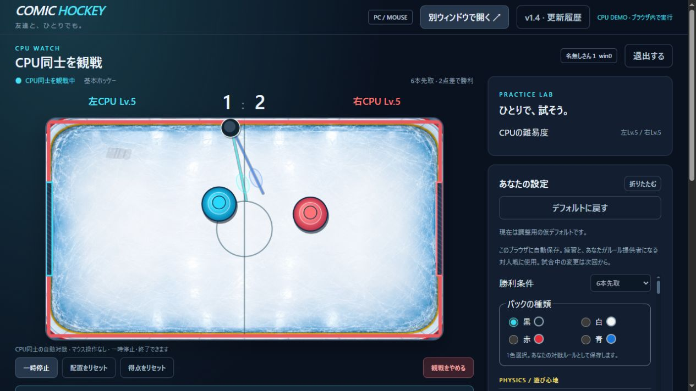

# online-airhockey

自分だけのルール・スキン・音・派手な打撃を楽しむ、PCとマウス用のエアホッケーです。入室画面からオンライン対戦・CPU練習・CPU観戦まで、現在のv1.4を独立した制作記録として保存しています。ゲーム内容はv1.3を継承し、作者の別ゲームへの入口を外しています。

- **試遊：[CPU対戦・CPU観戦](https://dybo46.github.io/online-airhockey/)**
- **制作記録：[GitHub](https://github.com/dybo46/online-airhockey)**
- **自分のサーバーへ設置：[SELF-HOSTING.md](SELF-HOSTING.md)**
- **機能と通信の仕組み：[ARCHITECTURE.md](ARCHITECTURE.md)**
- **後から変更分を取り込む：[UPDATING.md](UPDATING.md)**

このプロジェクトは作者のQNAP・ゲームサーバーと接続しません。作者のサーバーへ人を集める入口ではありません。ネット対戦する場合は、利用者自身のPC・QNAP・サーバーに設置してください。GitHub Pagesの試遊はブラウザ内のCPU戦専用です。



## 遊べること

- 左右のゴール、自陣を自由に動くパドル。6本／11本先取・2点差、デュースとアドバンテージ表示。失点した側がクリックしてセット。
- COOL! → DRIVE! → SMASH!の3段階の強打。クリックと衝突の時間差で判定し、連打を制限。強打を強打で返すとカウンターが加速。
- CPU10段階。通常打撃・成功・空振り、戦術の変化・短いドジ・壁際からの回り込み。CPU同士の観戦、1／2／4／8倍速、自動再戦、打撃統計。
- ゴール幅、パック・パドルのサイズ、初速・最高速、パドル速度、反射、打ち返し、滑りやすさ、強打受付・倍率・再使用待ち・カウンターを数値で調整。
- 設定のブラウザ保存、プリセット、JSON入出力、デフォルト復帰。パック色は黒・白・赤・青から1色。パドルは従来の水色と赤。
- 背景12種類＋「？」のランダム。打撃軌跡21種類、偏りのある抽選と強打時の直前除外。稀な虹パック・虹レーザー。v0.7の既存演出13種類は固定基準を保持。
- 効果音46候補の試聴・選択・音量・無音。実録エアホッケーと合成音を区別。強打の打撃音にレーザー音を重ねる。
- マウス固定・解除、別ウィンドウへの移動、一時停止・リセット・降参・終了。スマホ向けの操作や表示には対応していません。

設置版はさらに最大5人の待受、上から準備した2人の対戦、残りの人の観戦、勝者残留と再準備、セッション内のwin数に対応します。対戦ルールは、準備した2人のうち先順の人・準備済みの残留勝者の設定を開始時に採用し、対戦開始後に表示します。

## フォルダー

| 場所 | 内容 |
|---|---|
| `docs/` | GitHub Pagesで動くCPU専用デモ。ゲーム用APIなし。画像と音は同じサイトから読み込む |
| `self-host/` | 入室・オンライン・観戦・CPUを含むNode.js版。接続先は設置した自分のサイトだけ |
| `scripts/build-demo.mjs` | 設置版からCPU専用デモを生成。変換元が変わったときは停止 |
| `scripts/sync-upstream.mjs` | 別の開発フォルダーから許可したファイルだけを差分取り込み |
| `UPSTREAM.json` | 取り込み元と公開用ファイルのSHA256。個人のフォルダーパスは記録しない |
| `SNAPSHOT.json` / `HISTORY.md` | 現在版の内容と過去の機能変更の要約 |
| `AGENTS.md` | AI向けに公開環境の分離・演出の保護・更新方法を記録 |

## 手元で試す

Node.js 24以上。追加パッケージやビルドツールは不要です。

```sh
npm run demo
```

表示されたURLを開き、名前を決めてプレイ画面へ進みます。名前はCPU戦の表示用で、サーバーへの入室ではありません。「CPUと戦う」または「CPU同士を観戦」を選べます。

通常のChrome・Edgeで試してください。コートのクリックでマウスを固定し、Esc・右クリック・スペース・Backspace・Enterで解除します。ブラウザが固定を許可しない場合は画面に案内します。CPU戦はマウス解除・別タブへの移動で一時停止します。

オンライン版は `self-host` で `npm start`。詳しいネットワーク設定と確認は [設置資料](SELF-HOSTING.md) を参照してください。

## 記録と利用条件

最初の記録タグは **v1.4-record**。それ以前の変更はHISTORY.mdへ要約し、過去の全ソース履歴を移植したものとは扱いません。今後は差分を確認し、コミットとタグで版を残せます。作者の運用版へ自動で書き戻す処理はありません。

コード・生成画像の一般的なライセンスはまだ未選定です。外部音源はそれぞれのCC0・CC BYに従い、作者・出典・加工内容を同梱しています。[LICENSE-STATUS.md](LICENSE-STATUS.md) を確認してください。

```sh
npm test
npm run test:self-host
```
